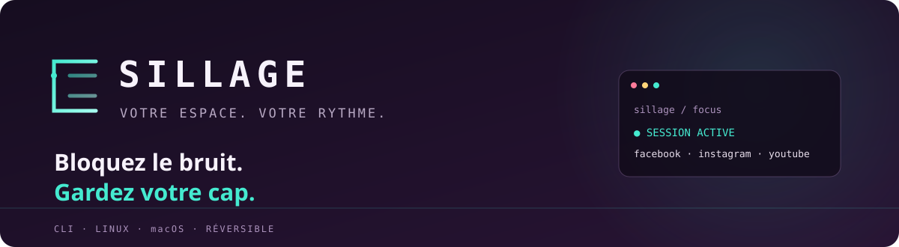
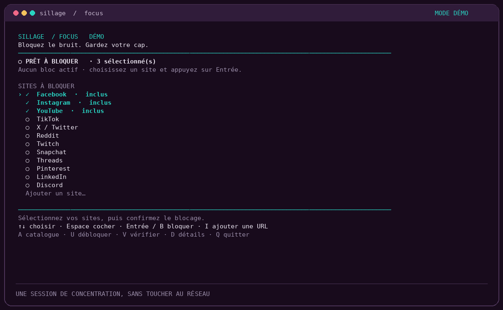
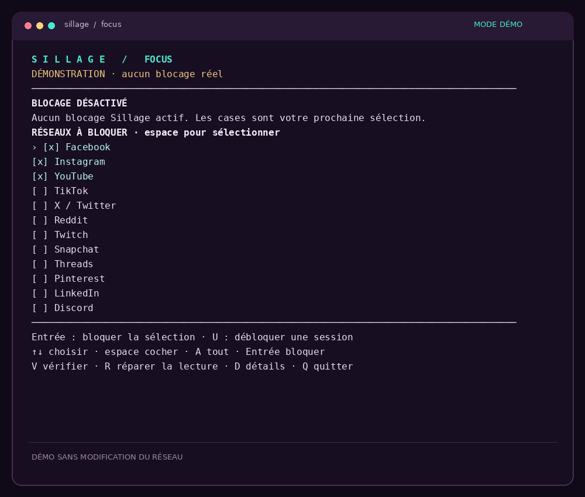

<div align="center">



<br>

**Un raccourci vers votre attention.**<br>
Mettez Facebook, Instagram, YouTube et d’autres distractions en pause, directement depuis le terminal.

<br>


</div>

<br>

## Sillage en action

La capture montre le tableau de bord. Le GIF présente le parcours de sélection et de confirmation en mode démo, sans modifier votre réseau.

<div align="center">

[](assets/sillage-cli.png)

<br>



</div>

<br>

```text
  S I L L A G E   /   FOCUS
  ─────────────────────────────────────────────
  ○ PRÊT À BLOQUER · 3 sélectionnés

  SITES À BLOQUER
  › ✓ Facebook · inclus
    ✓ Instagram · inclus
    ✓ YouTube · inclus
    ○ TikTok
    ○ Reddit
    + Ajouter un site…

  ↑↓ choisir · Espace cocher · Entrée / B bloquer · I ajouter une URL
```

## Commencer

Depuis un terminal, à la racine du projet :

```bash
npm ci
npm start
```

Choisissez les sites avec les flèches et **Espace**, ajoutez une URL avec **I** ou la ligne « Ajouter un site… », puis appuyez sur **Entrée** et confirmez. Sillage demande l’autorisation système nécessaire à la modification de `/etc/hosts` : fenêtre système sous Linux graphique, mot de passe dans le terminal sans interface graphique ou sous macOS.

Pour essayer sans toucher aux réglages réseau :

```bash
npm run demo
```

La démo utilise un `hosts` temporaire. Elle montre l’interface sans bloquer les sites.

## Les commandes utiles

| Commande | Action |
| --- | --- |
| `npm start` | Ouvrir le tableau de bord interactif |
| `npm run demo` | Découvrir l’interface sans blocage réel |
| `sudo "$(command -v node)" bin/sillage.js block` | Bloquer Facebook, Instagram et YouTube |
| `sudo "$(command -v node)" bin/sillage.js block reddit tiktok` | Bloquer une sélection précise |
| `sudo "$(command -v node)" bin/sillage.js block --url https://example.com/page` | Bloquer le domaine de cette URL |
| `sudo "$(command -v node)" bin/sillage.js block facebook --url example.com` | Combiner le catalogue et un domaine personnalisé |
| `sudo "$(command -v node)" bin/sillage.js block --url one.example --url two.example` | Bloquer plusieurs domaines personnalisés |
| `sudo "$(command -v node)" bin/sillage.js block --all` | Bloquer les 12 services du catalogue |
| `sudo "$(command -v node)" bin/sillage.js status` | Voir les marqueurs enregistrés dans `hosts` |
| `sudo "$(command -v node)" bin/sillage.js unblock` | Retirer le bloc Sillage et rétablir les permissions initiales |
| `node bin/sillage.js list` | Parcourir le catalogue |

Le catalogue comprend Facebook, Instagram, YouTube, TikTok, X, Reddit, Twitch, Snapchat, Threads, Pinterest, LinkedIn et Discord. Facebook, Instagram et YouTube sont présélectionnés. Une URL personnalisée est aussi acceptée ; son chemin et ses paramètres sont ignorés, seul son nom d’hôte est enregistré. Par exemple, `https://example.com/video?id=1` bloque `example.com`.

## Piloter au clavier

| Touche | Action |
| --- | --- |
| `↑` / `↓` | Se déplacer dans la liste |
| `Espace` | Cocher ou décocher un réseau |
| `A` | Sélectionner ou vider le catalogue prédéfini |
| `I` | Saisir une URL personnalisée |
| `Entrée` | Ajouter le site sélectionné ou lancer le blocage |
| `Retour arrière` | Retirer un domaine personnalisé de la sélection |
| `B` | Lancer le blocage de la sélection |
| `O` | Confirmer l’action proposée |
| `U` | Débloquer et terminer la session |
| `V` | Vérifier la résolution système des domaines sélectionnés |
| `D` | Afficher le chemin du fichier et des sauvegardes |
| `Q` / `Ctrl+C` | Quitter |

Les touches ne changent pas les réglages sans confirmation. Quitter laisse une session de blocage active. Une URL personnalisée bloque son nom d’hôte exact : les sous-domaines, autres domaines régionaux et chemins d’URL restent distincts.

## Ce que Sillage change

Sillage ajoute à `hosts` un bloc clairement délimité, qui redirige les domaines sélectionnés vers `0.0.0.0` et `::`. Le blocage couvre ainsi les résolutions IPv4 et IPv6. Une sauvegarde exacte et un journal sont conservés dans `.hosts.sillage`, dans un dossier privé.

Si `hosts` était trop privé pour que le navigateur lise ses règles, l’activation ajoute les permissions de lecture nécessaires aux utilisateurs locaux. **Au déblocage, les permissions d’origine sont restaurées.** Vérifiez les marqueurs avec `V` : « session active » signifie que le bloc existe ; « résolution bloquée » signifie que le résolveur système renvoie les adresses de blocage.

Le retrait enlève uniquement le bloc Sillage et préserve les autres lignes, y compris celles ajoutées pendant la session. Si le bloc ou sa sauvegarde a été modifié, Sillage s’arrête sans deviner quoi supprimer. Ne restaurez pas toute la sauvegarde à l’aveugle : vous pourriez effacer les modifications d’autres outils.

## Portée honnête

`hosts` agit sur des noms de domaine précis : il ne bloque pas automatiquement tous leurs sous-domaines, chaque domaine régional, les applications mobiles ou l’accès direct par adresse IP. Un navigateur avec DNS sécurisé, VPN ou proxy peut aussi contourner cette méthode. Les onglets déjà ouverts peuvent garder leur contenu en mémoire ; fermez complètement le navigateur puis rouvrez-le pour vérifier l’effet.

Sillage est un outil personnel de concentration, pas un pare-feu ni un contrôle parental. Il ne modifie pas votre DNS configuré, votre VPN, votre proxy ou votre pare-feu. Windows n’est pas pris en charge.

## Développement

```bash
npm test
npm run check
```

Les tests vérifient la restauration exacte du fichier et des permissions, la conservation des changements extérieurs et la récupération des interruptions. Ils utilisent des fichiers temporaires ; ils ne modifient pas `/etc/hosts`.

<div align="center">

**Faites une place au travail qui compte.**

</div>
